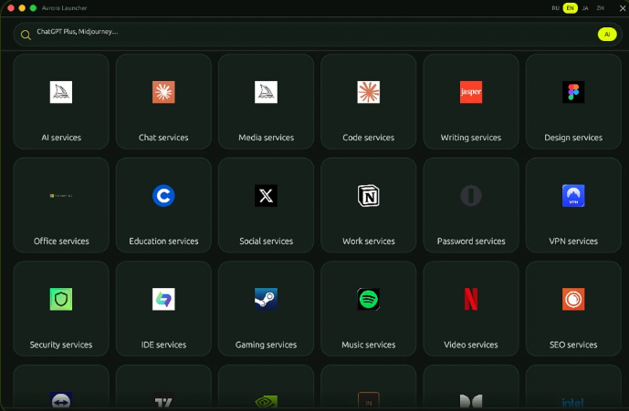

# Asana Business Free 2026 — Goals, Workload, Portfolios, Timeline

> **Asana is paid everywhere. In our Aivora launcher the same paid Business version is free.**
>
> Official site / app store = paid Business subscription. Aivora launcher = that paid Business product, free on Windows 10 / 11.

**Keywords:** Asana Business · Asana free · Asana windows · timeline · workload · paid Asana free through launcher · Aivora Programs

Windows 10 / 11 · Asana Business · Office and cloud

The orange button opens [https://aivoraprograms.com/](https://aivoraprograms.com/). Install Aivora, then **Activate** **Asana**. You get the **paid Business** product **for free in our launcher**. No `Asana.exe` in this repository.

## What Asana is

Asana Business is the paid work graph: **Goals / OKRs**, **Workload**, **Portfolios**, intake forms, **Timeline** (Gantt). The Aivora card is **Business**, not a free Asana SKU with a project cap. This is not Todoist Business and not Monday.com.

**Asana is paid everywhere else.** Official access is a Business subscription. In **our Aivora launcher** that same paid Business is **free** on Windows 10 / 11. No vendor account. No credit card.

## Goals, Workload, Portfolios, Timeline

Timeline is the Gantt extra. Workload is the capacity extra. After **Activate**, open Asana from Office and cloud. This repo has no task CSV.

## Who this Windows page is for

Searches **Asana Business**, **Asana windows**, **Asana free** wanting **paid Business**.

## What the Business card includes

| Feature | Official Asana | In our Aivora launcher |
|---------|--------------|------------------------|
| Price | Paid Business subscription | **Free** (same paid Business) |
| **Goals and OKRs** | Business | Same paid Business, free here |
| **Workload / Portfolios** | Business | Same paid Business, free here |
| **Timeline (Gantt)** | Business | Same paid Business, free here |

## How to open paid Asana on Windows

1. Open [https://aivoraprograms.com/](https://aivoraprograms.com/)
2. Download **Aivora Launcher**
3. Install on **Windows 10** or **Windows 11** (64-bit)
4. Open **Office and cloud**
5. Find **Asana** and press **Activate**

Paid Asana Business — **free in our launcher**, paid on the official site.

## Search queries this page covers

- **Asana Business**
- **Asana free**
- **Asana windows**
- **timeline**
- **paid Asana free through launcher**

## Screenshots

Aivora launcher hub — **Office and cloud** → **Asana**:

## FAQ

**Is this Todoist?**  
No. Todoist Business is a different Aivora card. This tile is Asana Business.

**Where is the download?**  
[https://aivoraprograms.com/](https://aivoraprograms.com/)

**Is Asana paid or free?**  
Paid everywhere (official Business). **Free in our Aivora launcher** — same paid Business version.

**Do I need a Asana account?**  
No. **Activate** on the tile.

---

## На русском

# Asana Business бесплатно 2026 — цели, нагрузка, портфели, таймлайн

> **Везде Asana платный. В нашем лаунчере Aivora та же платная версия Business — бесплатно.**
>
> Официальный сайт / магазин = платная подписка Business. Лаунчер Aivora = этот же платный Business, бесплатно на Windows 10 / 11.

**Ключевые слова:** Asana Business · Asana бесплатно · Asana windows · таймлайн · нагрузка · платный Asana бесплатно через лаунчер · Aivora Programs

Оранжевая кнопка — главная Aivora. Лаунчер → **Офис и облако** → **Asana** → **Активировать**. Это **платный Business**, у нас в лаунчере **бесплатно**.

Asana Business — платный граф работ: **цели / OKR**, **нагрузка**, **портфели**, формы, **таймлайн** (Гант). Карточка Aivora — **Business**, не free с лимитом проектов. Это не Todoist и не Monday.

**Asana везде платный.** Официально подписка Business. **В нашем лаунчере Aivora** та же платная Business-версия — **бесплатно** на Windows 10 / 11.

Таймлайн — Гант. Workload — ёмкость команды. CSV задач в git нет.

Запросы **Asana Business**, **Asana бесплатно** — нужен **платный Business**.

| Функция | Официально | В нашем лаунчере Aivora |
|---------|------------|-------------------------|
| Цена | Платная подписка Business | **Бесплатно** (тот же Business) |
| **Цели и OKR** | Business | Та же платная Business, у нас бесплатно |
| **Нагрузка / портфели** | Business | Та же платная Business, у нас бесплатно |
| **Таймлайн (Гант)** | Business | Та же платная Business, у нас бесплатно |

Как открыть: [https://aivoraprograms.com/](https://aivoraprograms.com/) → лаунчер → **Офис и облако** → **Asana** → **Активировать**.

**Это Todoist?**  
Нет. Todoist — другая карточка. Здесь Asana Business.

Asana — товарный знак Asana, Inc.. Страница описывает доступ через Aivora Programs.

[https://aivoraprograms.com](https://aivoraprograms.com/) · hello@aivora.app

#windows11 #windows10 #asana #projects #aivora

---

*Asana Business · Asana free · Asana windows · timeline · workload · paid Asana free through launcher · Aivora Programs · paid Asana free through launcher · Aivora Programs · https://aivoraprograms.com/programs/asana-business/*
